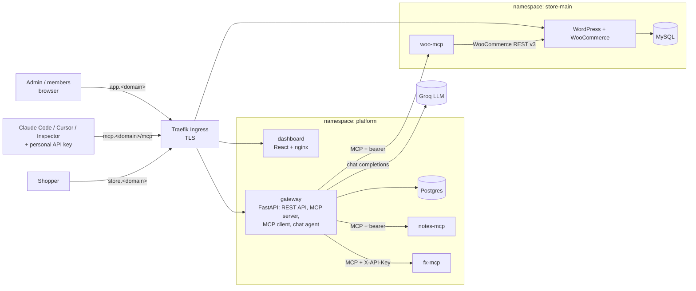

# Urumi MCP Gateway

A **team MCP gateway** on Kubernetes, with a WooCommerce store as its first data source.

- An **admin** registers MCP servers once in a dashboard (URL + optional credential).
- Every **team member** connects any MCP client (Claude Code, Cursor, MCP Inspector) to **one gateway URL with their own API key** and sees the tools of every enabled server.
- A **chat agent** in the dashboard uses the same gateway, acting as the logged-in user.
- The store's MCP server (`woo-mcp`) is written here and is reachable **only** by the gateway.
- Everything is deployed with **Helm**: locally on **k3d**, in production on **k3s on an Azure VM**, with only values changing.

**Live:** https://app.urumi-sajjad.duckdns.org (dashboard) · https://store.urumi-sajjad.duckdns.org (store) · `https://mcp.urumi-sajjad.duckdns.org/mcp` (MCP endpoint, API key required)

---

## Architecture



**Golden rule:** nothing but the gateway talks to upstream MCP servers. Clients and the chat agent only ever talk to the gateway, and the chat agent is itself an MCP client of the gateway's own `/mcp` endpoint, so it goes through the same auth, permission and audit path as Claude Code.

| Component | What it does |
|---|---|
| `services/gateway` | Python 3.12, FastAPI, official `mcp` SDK. Dashboard REST API, auth (sessions, API keys, chat tokens), upstream registry with Fernet-encrypted credentials, health monitor, tool catalog, `/mcp` aggregation + routing, tool permissions, audit log, chat agent |
| `services/woo-mcp` | MCP server (FastMCP, Streamable HTTP) over the WooCommerce REST API: `get_store_info`, `list_products`, `create_product`, `list_orders`, `get_order`, `update_order_status` |
| `services/notes-mcp`, `services/fx-mcp` | Two more upstreams: bearer vs header credentials, a deliberate tool-name collision (`search`), fault injection for the slow-upstream test |
| `services/dashboard` | React + Vite + TypeScript SPA served by unprivileged nginx |
| `deploy/charts/woo-store` | One store = WordPress + MySQL + bootstrap Job + woo-mcp + NetworkPolicies |
| `deploy/charts/platform` | gateway + dashboard + Postgres + notes-mcp + fx-mcp + NetworkPolicies |

Tools are always exposed as `<server-slug>__<tool>` (e.g. `woo__list_orders`, `notes__search` vs `fx__search`), so names never collide and the model sees which system a tool acts on.

Details: [system design and trade-offs](docs/system-design-and-tradeoffs.md) · [threat model](docs/threat-model.md) · [full v1 design](docs/design/v1-system-design.md)

---

## Run it locally (k3d)

**Prerequisites:** Docker Desktop (8 GB for its VM), [k3d](https://k3d.io), kubectl, Helm, Python 3.12, [uv](https://docs.astral.sh/uv/), Git Bash on Windows. A free [Groq](https://console.groq.com) API key for the chat agent.

```bash
python scripts/gen_secrets.py local          # random passwords/keys -> deploy/secrets/local.secrets.yaml (gitignored)
# put your Groq key into groqApiKey in that file
bash scripts/up.sh                           # k3d cluster, image builds, both Helm releases (~7 min with cached images)
```

Then open:

| URL | What |
|---|---|
| http://store.127-0-0-1.nip.io | WooCommerce storefront (checkout with Cash on Delivery) |
| http://app.127-0-0-1.nip.io | Dashboard. First login: `bootstrapAdminEmail` / `bootstrapAdminPassword` from the secrets file |
| http://mcp.127-0-0-1.nip.io/mcp | MCP endpoint for clients |

`*.127-0-0-1.nip.io` is public wildcard DNS that resolves to 127.0.0.1, so no hosts-file edits are needed ([local domains](docs/local-domains.md)). `bash scripts/down.sh --yes` deletes the cluster.

### Connect an MCP client

Create a key on the dashboard's **API keys** page (shown once, stored only as a SHA-256 hash), then for example:

```bash
claude mcp add -s user --transport http urumi http://mcp.127-0-0-1.nip.io/mcp --header "Authorization: Bearer mcpgw_..."
```

The dashboard's **Connect a client** page has snippets for Claude Code, Cursor, VS Code and MCP Inspector.

---

## Production (k3s on Azure)

Same two charts; only `deploy/values/*/values-prod.yaml`, the secrets file and the image location differ.

- **Images:** `.github/workflows/images.yml` builds the 5 images on every push to `main` and publishes them to GHCR, tagged with the commit SHA.
- **VM:** Azure B2as_v2 (2 vCPU, 8 GB), Ubuntu 24.04, k3s v1.35.5 (same as local), Traefik, cert-manager + Let's Encrypt (HTTP-01).
- **Deploy:** `bash scripts/deploy-prod.sh <image-sha>` on the VM (preflight checks, issuers, both `helm upgrade --install`).

Step-by-step guide, including the Azure for Students pitfalls: [docs/vps-setup.md](docs/vps-setup.md).

---

## Tests

| What | How | Result |
|---|---|---|
| Unit + integration | `uv run pytest` in each Python service | gateway 50, woo-mcp 13, notes-mcp 3, fx-mcp 3 |
| Acceptance (demo script, design §15) | `bash scripts/acceptance.sh [domain] [--prod]` | 59/59 locally from an empty cluster and on production |
| Network isolation | `bash scripts/netpol-test.sh [domain]` (part of acceptance) | 28/28: 12 allowed paths, 16 denied (incl. gateway → Kubernetes API, cloud metadata, MySQL) |

The acceptance script covers: storefront COD checkout, chat creating a product, orders today, invite + API key, cross-server prompt (woo → fx → notes), key revocation (401), disabling a server (`tools/list_changed`, direct call rejected), killing an upstream (others keep working), a slow upstream (20 s timeout, no retry), role-based tool permissions, unauthorized requests, SSRF rejection and the audit trail.

---

## Repository layout

```text
services/            gateway, woo-mcp, notes-mcp, fx-mcp, dashboard (each with Dockerfile and tests)
deploy/charts/       platform, woo-store Helm charts
deploy/values/       values-local.yaml / values-prod.yaml per chart
deploy/k3d/          local cluster config
deploy/prod/         Let's Encrypt ClusterIssuers
deploy/secrets/      secrets.example.yaml (real files are generated and gitignored)
scripts/             gen_secrets, up/down, build-images, deploy-prod, acceptance, netpol-test
spikes/              Phase 0.5 MCP SDK experiments
docs/                design, trade-offs, threat model, VPS setup, local domains, demo script
.github/workflows/   image build + push to GHCR
```
