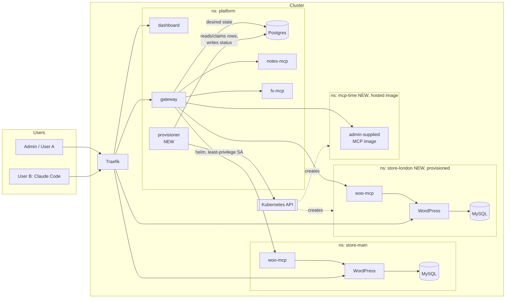
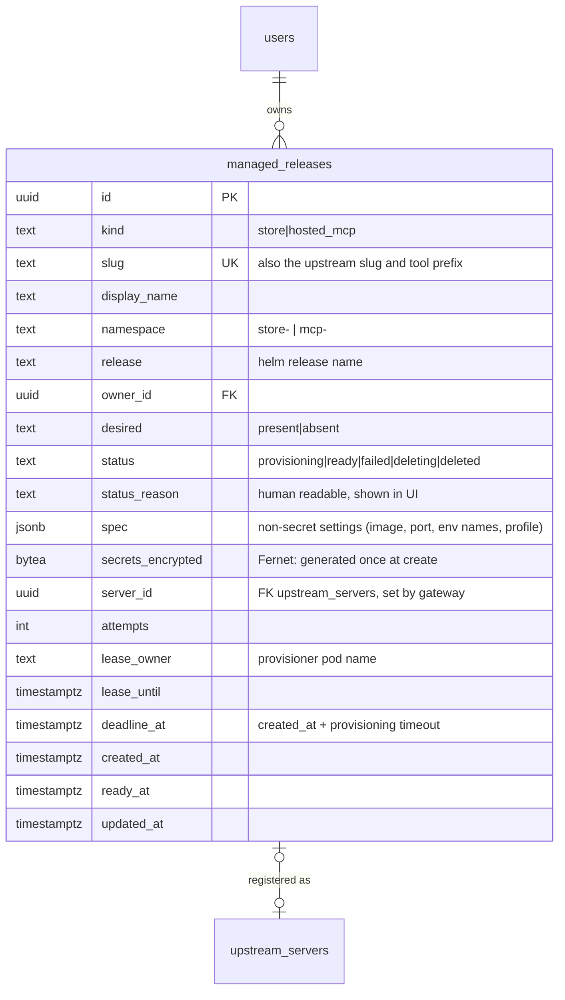
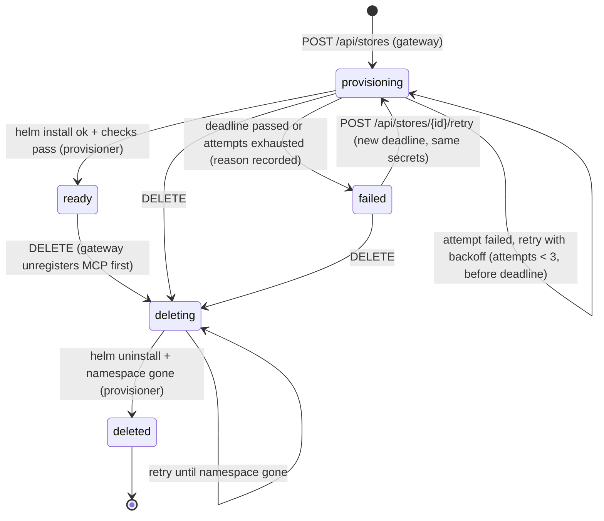
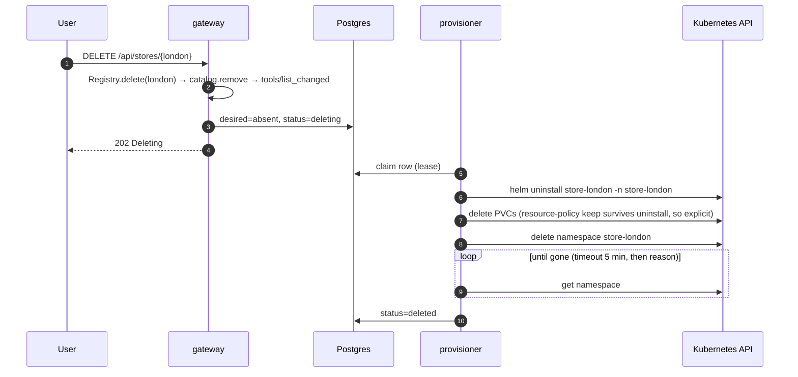
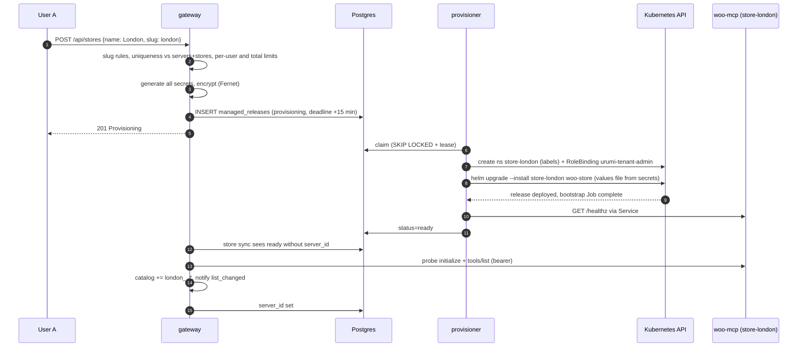

# Urumi MCP Gateway — v2 System Design

> Status: **approved; Phases 10.0–10.4 complete locally; Phase 10.5 next** (updated 2026-10-20). v2 builds on top of the implemented and deployed v1.
> [v1-system-design.md](v1-system-design.md) stays **frozen** as the original plan. This document only describes **what changes**; anything not mentioned here works exactly as v1 says.
> Deadline: **2026-10-22**. Feature freeze: **2026-10-21 12:00 IST** (§16).

---

## 0. Table of contents

1. [Why v2](#1-why-v2)
2. [Scope, order and cut line](#2-scope-order-and-cut-line)
3. [Requirements traceability (bonus + stand-outs)](#3-requirements-traceability)
4. [Architecture changes](#4-architecture-changes)
5. [Provisioner (shared machinery for A and hosted MCP)](#5-provisioner)
6. [A. Multi-store provisioning (bonus)](#6-a-multi-store-provisioning-bonus)
7. [Hosted MCP servers (stand-out 5)](#7-hosted-mcp-servers-stand-out-5)
8. [B. Observability (stand-out 8)](#8-b-observability-stand-out-8)
9. [E. Upgrades and rollback (stand-out 9)](#9-e-upgrades-and-rollback-stand-out-9)
10. [C. Handling many tools (stand-out 4)](#10-c-handling-many-tools-stand-out-4)
11. [D. Security completion (stand-outs 6 + 7)](#11-d-security-completion)
12. [Item 0: required fixes and polish](#12-item-0-required-fixes-and-polish)
13. [Dashboard changes](#13-dashboard-changes)
14. [Helm, values and local vs production](#14-helm-values-and-local-vs-production)
15. [Testing](#15-testing)
16. [Build plan, gates and cut line](#16-build-plan-gates-and-cut-line)
17. [Demo video plan](#17-demo-video-plan)
18. [Decisions (ADR-16 onwards)](#18-decisions)
19. [Risks](#19-risks)
20. [Still out of scope, and why](#20-still-out-of-scope-and-why)

---

## 1. Why v2

v1 satisfies every mandatory requirement and two stand-outs (VPS + TLS, tool permissions), verified by 59/59 acceptance + 28/28 isolation checks locally and on `https://*.urumi-sajjad.duckdns.org`.

v2 aims to go from "complete" to "clearly above the bar":

- the **bonus** (multi-store provisioning), which reuses the v1 decision to make one store = one chart = one namespace (v1 §4.1);
- **depth in one area**: a Kubernetes-native **provisioner** that also runs admin-supplied MCP images (stand-out 5), with least-privilege RBAC enforced by an admission policy;
- the stand-outs that the demo video must talk about anyway (observability, upgrade/rollback, security posture).

**Invariants carried over from v1 (never broken by v2):**

1. Nothing except the gateway talks to upstream MCP servers.
2. Client tokens are never forwarded upstream; upstream credentials never leave the server side.
3. Every tool call goes through auth → permission → router → audit, including the chat agent.
4. Same Helm charts locally and in production; differences only in values.
5. `tools/call` is never retried.
6. Every v1 acceptance check (59) and isolation check (28) keeps passing after every v2 phase.

---

## 2. Scope, order and cut line

Agreed order (user, 2026-10-18). We build top to bottom and **cut from the bottom** if we fall behind.

| # | Item | Brief reference | Estimate |
|---|---|---|---|
| 0 | v2 doc, required README fixes, notes PVC, chat tables, response-size cap, ruff config | Deliverables | ~0.5 day |
| 1 | **Provisioner + RBAC → A: multi-store** | Bonus | ~1.5 days |
| 2 | **Hosted MCP servers** (reuses the provisioner) | Stand-out 5 | ~0.5 day |
| 3 | **B: metrics + dashboard page** | Stand-out 8 | ~0.5 day |
| 4 | **E: live upgrade and rollback** | Stand-out 9 | ~1 hour |
| 5 | **C: `search_tools` / `call_tool`** | Stand-out 4 | ~0.5 day |
| 6 | **D: default-deny egress everywhere + rate limits** | Stand-outs 6, 7 | ~0.5 day |
| — | Release: prod deploy, full acceptance, video, submit | Mandatory | Oct 21 afternoon |

**Cut line:** feature freeze at **2026-10-21 12:00 IST**. Whatever is not through its gate by then is cut, documented as "designed, not built", and the rest of the day goes to the production deploy, the full acceptance run and the video. Oct 22 is buffer only.

Why this order: A has the highest value and the highest risk, so it goes first while there is the most time. Hosted MCP is cheap once the provisioner exists. B and E are needed for the video's "observability" and "upgrade and rollback" sections. C and D are valuable but each stands alone, so they are safe to cut.

---

## 3. Requirements traceability

### 3.1 Bonus: multi-store provisioning

| Brief requirement | Where / how |
|---|---|
| Create and delete stores from the dashboard | Stores page + `POST/DELETE /api/stores` — §6.2, §13 |
| List with status (Provisioning / Ready / Failed), URL, created time | `managed_releases` rows — §5.3, §13 |
| Several stores provisioned at the same time | provisioner worker pool (default 2 concurrent) — §5.5 |
| Helm or Kubernetes API, own namespace, DB, Secrets, PVs, Ingress host | `helm upgrade --install store-<slug> woo-store -n store-<slug>` (the **same chart** as `store-main`) — §6.3 |
| Own WooCommerce MCP server, auto-registered, store-clear tool names | woo-mcp ships in the chart; gateway registers `<slug>` → tools `london__list_orders` — §6.4 |
| Clean teardown: namespace, volumes, Secrets, MCP registration | unregister first, then `helm uninstall` + delete namespace + wait — §6.5 |
| Isolation shown with NetworkPolicies | per-namespace default deny; woo-mcp → only its own WordPress — §6.6, netpol tests §15 |
| ResourceQuota + LimitRange per namespace, max stores per user, provisioning timeout | chart templates + API guard + deadline — §6.7 |
| Safe to retry; provisioner restart → completes or fails cleanly with reason | idempotent API, secrets generated once, leases, reconcile on start — §5.6 |
| Test: chat compares today's orders across two stores, then delete one and show tools + resources gone | demo + acceptance — §15, §17 |

### 3.2 Stand-outs

| # | Stand-out | v1 | v2 |
|---|---|---|---|
| 1 | Production VPS deployment (+ TLS) | ✅ full | new components deployed the same way |
| 2 | Tool permissions | ✅ full | applies to new store and hosted tools unchanged |
| 3 | OAuth on the gateway | — | out of scope (§20) |
| 4 | Handling many tools | — | **C**: meta-tools + `/mcp/search` endpoint (§10) |
| 5 | Hosted MCP servers | — | **added** (§7) |
| 6 | Security hardening | SSRF, encrypted creds, non-root, ingress default-deny, gateway egress | **D**: default-deny egress everywhere, least-privilege RBAC + admission policy, response-size cap, credential key rotation (§11) |
| 7 | Scaling | — | per-user rate limits only (§11.3); replicas out of scope (§20) |
| 8 | Observability | unreachable reasons | **B**: Prometheus metrics, per-server stats page, classified failure reasons (§8) |
| 9 | Upgrades and rollback | documented | **E**: demoed live, versions visible in the UI (§9) |

### 3.3 Deliverable gaps found in the v1 review

| Gap | Fix (item 0) |
|---|---|
| README has no list of the bonus/stand-outs we attempted, or where to find them | new README section "What we built beyond the core" with links |
| README lacks clear "place an order" and "use the chat agent" walkthroughs | new README sections |
| Response size cap (v1 §9.4) not implemented | §11.4 |

---

## 4. Architecture changes



What is new:

| Component | Responsibility | Exposed? |
|---|---|---|
| **provisioner** (new Deployment in `platform`) | Reconciles `managed_releases` rows into Helm releases: install, wait, fail with reason, uninstall, delete namespace. The **only** component with Kubernetes API access. | No |
| **managed_releases** table (gateway DB) | Desired + observed state of every provisioned store and hosted MCP server | — |
| `store-<slug>` namespaces | One per provisioned store, same `woo-store` chart as `store-main` | storefront host only |
| `mcp-<slug>` namespaces | One per hosted MCP server, new small `hosted-mcp` chart | No |
| gateway `/metrics`, `/api/stats` | Prometheus metrics, per-server stats for the dashboard | No (`/metrics` is not routed by Ingress) |

**Key design choice: the gateway never gets Kubernetes API access.** The gateway is internet-facing and holds every upstream credential; giving it the power to create namespaces would make one gateway bug a cluster compromise. Instead, the gateway writes *what should exist* into Postgres, and a separate, non-exposed provisioner with its own narrow ServiceAccount makes it exist. The v1 egress policy that blocks the gateway from the Kubernetes API (verified by netpol-test) stays exactly as is. (ADR-16)

---

## 5. Provisioner

### 5.1 Responsibilities

- Watch `managed_releases` (poll every 3 s; Postgres is already there, no new queue).
- For each row that needs work: claim it with a lease, run Helm, write the observed status back.
- Never register MCP servers itself: the **gateway** owns the registry (it has the catalog, notifications and SSRF checks). The provisioner only reports `ready`.

### 5.2 Packaging

- Code: new module `services/gateway/src/gateway/provisioner/` (reuses `db`, `models`, `security.CredentialBox`, logging and config from the gateway package, so there is one table definition and one migration history).
- Image: separate `urumi-provisioner` image built from `services/provisioner/Dockerfile` (build context = repo root): gateway package + pinned `helm` binary (sha256-verified at build) + the `woo-store` and `hosted-mcp` charts copied in. The gateway image stays without Helm and without charts.
- Runs as uid 10001, read-only root FS, `/tmp` emptyDir for Helm's cache and temporary values files.
- Why the charts are baked into the image: a provisioned store is installed from exactly the chart version that shipped with that provisioner image, so an upgrade or rollback of the provisioner is also an upgrade or rollback of what it installs. (ADR-17)

### 5.3 Data model



- `slug` follows the v1 slug rules (`^[a-z0-9]+(-[a-z0-9]+)*$`, ≤ 20 chars, no `__`) and is unique **across** `upstream_servers` and `managed_releases`, so a store can never take over an existing server's tool prefix.
- `secrets_encrypted` holds every generated secret for that release (MySQL root + user passwords, WP admin password, Woo consumer key/secret, woo-mcp token; or the hosted server's env secrets + generated bearer token). It is generated **once**, in the create request. Retries reuse it, which matters: MySQL keeps the password from its first initialisation, so a retry with new passwords would break the store.
- Rows are soft-deleted (`status=deleted`) so the history stays visible; the slug can then be reused.

### 5.4 State machine



`ready` requires more than "Helm said ok": the provisioner also checks that the bootstrap Job completed, the woo-mcp Service has a ready endpoint, and the storefront answers through the in-cluster Service. Only then does the gateway register the server.

### 5.5 Reconcile loop and concurrency

```text
every 3 s:
  rows = SELECT … FROM managed_releases
         WHERE status IN ('provisioning','deleting')
           AND (lease_until IS NULL OR lease_until < now())
         ORDER BY created_at
         FOR UPDATE SKIP LOCKED
         LIMIT free_workers
  for each row: set lease_owner = pod, lease_until = now() + 60 s, then hand to a worker
workers (asyncio, default 2): renew lease every 20 s while Helm runs
```

- **Several at once:** two workers by default (`provisioner.concurrency`), so two stores provision in parallel; a third waits in `provisioning` with reason "queued".
- **Safe with more than one provisioner pod:** `FOR UPDATE SKIP LOCKED` + lease means two pods never work the same row. v2 still runs one replica (`strategy: Recreate`) to keep resources low; the lease is what makes a crash safe.
- Helm runs as a subprocess with an argument list (never a shell string). Secret values go into a temporary values file (mode 600, deleted in `finally`), never into command-line arguments (which are visible in the process list). Helm stdout/stderr are logged with secret values masked.

### 5.6 Idempotency, retry and recovery

| Situation | Behaviour |
|---|---|
| User double-clicks "Create" or the browser retries the POST | Same user + same slug while not `deleted` → `200` with the existing row, no second release. Different user + same slug → `409`. |
| Helm attempt fails (e.g. image pull slow, bootstrap Job failed) | Reason recorded (`status_reason`), backoff 15 s → 30 s, `helm upgrade --install` again (idempotent). Max 3 attempts. |
| Provisioner pod killed mid-install | Lease expires within 60 s; the new pod claims the row. If Helm left the release in `pending-install`/`pending-upgrade` (lock left by the killed process), the provisioner runs `helm rollback` (pending-upgrade) or `helm uninstall --keep-history` (pending-install) and then installs again. PVCs keep their data (`resource-policy: keep`), and secrets are the same, so the retry continues where it stopped. |
| Deadline passes (default 15 min, values `provisioner.timeoutMinutes`) | `failed`, reason e.g. "Timed out after 15 min: bootstrap Job did not complete (last log: …)". Resources stay for inspection until the user deletes or retries. |
| Gateway down while a store becomes ready | Nothing lost: the gateway's store sync (§6.4) registers every `ready` row without a `server_id` when it starts. |
| Delete while provisioning | Worker notices `desired=absent` at its next lease renewal, stops waiting, and teardown starts. |

### 5.7 RBAC: least privilege, enforced by an admission policy

Kubernetes RBAC alone cannot say "only namespaces whose name starts with `store-`": `create` can't be limited by name. So the provisioner gets two layers:

**Layer 1: RBAC**

| Object | Grants |
|---|---|
| ClusterRole `urumi-provisioner` (ClusterRoleBinding to SA `platform/provisioner`) | `namespaces`: get, list, watch, create, delete, patch · `rolebindings` (rbac): create, get, delete · `bind` on ClusterRole `urumi-tenant-admin` only (`resourceNames`) |
| ClusterRole `urumi-tenant-admin` (**never** bound cluster-wide) | Exactly what the two charts create, inside one namespace: Secrets, ConfigMaps, Services, PVCs, Deployments, StatefulSets, Jobs, Pods (get/list/log for checks), Ingresses, NetworkPolicies, ResourceQuotas, LimitRanges, ServiceAccounts, cert-manager Certificates (read) |

Flow for a new store: create namespace `store-london` (labelled) → create RoleBinding in that namespace binding `urumi-tenant-admin` to the provisioner's SA → run Helm. The provisioner can **not** read Secrets in `platform`, `kube-system` or `store-main`, because it has no binding there.

**Layer 2: ValidatingAdmissionPolicy** (built into Kubernetes ≥ 1.30, so built into our k3s v1.35, no extra component). Requests from the provisioner's SA are rejected unless:

- a created namespace's name matches `^(store|mcp)-[a-z0-9-]{1,20}$` **and** it carries `urumi.io/managed-by: provisioner`;
- a deleted or patched namespace carries that label (so `store-main`, `platform` and `kube-system` can never be deleted by it);
- a RoleBinding is created only in a namespace with that label, only for ClusterRole `urumi-tenant-admin`, only for its own SA.

So even a compromised provisioner can't escalate outside its own tenant namespaces. The demo shows this with `kubectl auth can-i --as=system:serviceaccount:platform:provisioner` and a rejected `kubectl delete ns store-main --as=…`. (ADR-18)

### 5.8 Network

- Provisioner egress: DNS, Postgres :5432, the Kubernetes API (k3s: the `kubernetes` Service ClusterIP :443 and the node's API port 6443, given as `provisioner.apiServerCidrs` in values because NetworkPolicies see the post-NAT address; verified per environment), plus in-cluster HTTP to tenant namespaces for readiness checks. Nothing else.
- Provisioner ingress: none (it has no Service).
- Postgres ingress policy: add the provisioner next to the gateway.

---

## 6. A. Multi-store provisioning (bonus)

### 6.1 User flow

1. User opens **Stores**, sees `main` (the v1 store, marked "built-in") and any provisioned stores with status, URL and created time.
2. Clicks **Create store**, enters a name ("London"), slug suggested (`london`), clicks Create.
3. Row appears as **Provisioning** with a live reason ("installing chart", "waiting for WordPress", "running bootstrap", "registering MCP server"). Polling every 3 s.
4. About 2–3 minutes later: **Ready**, with the storefront link `store-london.<domain>`. The Servers page shows a new server `london` (Connected, 6 tools), and every open MCP session gets `tools/list_changed`.
5. Chat: "Compare today's orders in main and London" → `woo__list_orders` + `london__list_orders` → comparison.
6. **Delete** (with type-the-name confirmation) → tools disappear immediately, row shows **Deleting**, then the row moves to history; the namespace, PVCs and Secrets are gone.

### 6.2 API

| Method & path | Role | Purpose |
|---|---|---|
| `GET /api/stores` | any | own stores (admin: all) + the built-in store; `?include=deleted` for history |
| `POST /api/stores` `{name, slug}` | any | create (idempotent per user + slug, §5.6); guards §6.7 |
| `POST /api/stores/{id}/retry` | owner/admin | `failed` → `provisioning`, new deadline |
| `DELETE /api/stores/{id}` | owner/admin | unregister + teardown |

Who can create: any user (the brief says "a user can create and delete stores"). Members delete only their own; admins delete any. The built-in `store-main` is not in `managed_releases` and can't be deleted from the UI.

Tool permissions for a new store follow v1 unchanged: read tools for everyone, `create_product`/`update_order_status` admin-only by default. A member who owns a store therefore can't create products in it unless an admin opens that tool; documented, deliberate (one permission model, not two).

### 6.3 Chart: same chart, new values

`helm upgrade --install store-<slug> /charts/woo-store -n store-<slug> -f /charts/woo-store/values-tenant.yaml -f <generated values>`

Changes to the `woo-store` chart (they also apply to `store-main`, keeping one chart):

| Change | Why |
|---|---|
| `store.subdomain` set per store → host `store-<slug>.<domain>` | stable Ingress host per store; works with nip.io and DuckDNS wildcards; one cert per host in prod |
| New `ResourceQuota` + `LimitRange` templates (`quota.enabled`) | guardrails (§6.7) |
| New `values-tenant.yaml` profile: smaller requests/limits, 2 Gi PVCs, `sampleProducts: true` | 8 GB VM must fit main + 2 tenants |
| Namespace labels `urumi.io/mcp-upstreams: "true"`, `urumi.io/managed-by: provisioner`, `urumi.io/tenant: <slug>` (set by the provisioner at namespace create) | gateway egress selector (§6.6), admission policy (§5.7) |
| Store title from `display_name` | storefront shows the store's name |

Secrets for the release come from `secrets_encrypted` → temporary values file → the chart's existing `secrets.yaml` templates (v1 §4.2 names and keys). No chart secret logic changes.

### 6.4 Automatic MCP registration (gateway side)

A gateway background task, **store sync** (every 3 s, and once at startup):

- `ready` row without `server_id` → `Registry.create(slug=<slug>, name="WooCommerce (<display_name>)", url=http://woo-mcp.store-<slug>.svc.cluster.local:8000/mcp, auth=bearer <woo-mcp token from secrets_encrypted>)` → probe → catalog → `tools/list_changed`. Then write `server_id` back to the row.
- Tool names: `<slug>__list_orders`, descriptions prefixed `[WooCommerce (London)]`: the prefix tells the model and the user which store a tool acts on (v1 §8.2 already chose always-prefix with this bonus in mind).
- The URL passes the same SSRF guard as an admin-entered URL (`*.store-*.svc.cluster.local` is already on the allowlist).
- Registration is marked `is_managed` (new column on `upstream_servers`): the Servers page shows "managed by store London"; admins can disable it there, but delete goes through the store (one owner per lifecycle).

### 6.5 Teardown



Unregistering **first** means the store's tools are gone from every client the moment the user clicks Delete, even if the Kubernetes teardown takes a minute. Deleting the namespace removes everything namespaced (Secrets, PVCs → `local-path` deletes the volume data, Ingress, NetworkPolicies, quota). The acceptance test asserts each of these is gone.

### 6.6 Isolation (NetworkPolicies)

The existing `woo-store` policies already scope everything to the release's own namespace (a `podSelector` without `namespaceSelector` only matches pods in the same namespace):

| From → To | Expected |
|---|---|
| gateway → woo-mcp in `store-london` | allowed |
| woo-mcp `store-london` → WordPress `store-london` | allowed |
| woo-mcp `store-london` → WordPress `store-main` | **denied** |
| woo-mcp `store-london` → MySQL `store-main` / `store-london` | **denied** |
| WordPress `store-london` → MySQL `store-main` | **denied** |
| any pod in `store-london` → woo-mcp `store-main` | **denied** |
| hosted MCP pod → anything in `store-*` or `platform` | **denied** |

Gateway egress change: v1 listed upstream namespaces by name (`gateway.upstreamNamespaces`). New namespaces appear at runtime, so the selector becomes the label `urumi.io/mcp-upstreams: "true"` (what v1 §9.3 originally described). Only cluster admins and the provisioner (restricted by the admission policy) can set namespace labels. `store-main` and `platform` get the label from the deploy scripts.

These rows are added to `scripts/netpol-test.sh` and run against a real provisioned store.

### 6.7 Guardrails

| Guard | Default (local / prod) | Where enforced |
|---|---|---|
| Max stores per user | 2 / 2 | gateway API (`409` with reason) |
| Max provisioned stores total | 3 / 2 | gateway API (protects the 8 GB VM) |
| Provisioning timeout | 15 min | provisioner deadline → `failed` with reason |
| Teardown timeout | 5 min | provisioner → stays `deleting` with reason, retried |
| ResourceQuota per store namespace | requests 1 CPU / 1.5 Gi, limits 3 CPU / 3 Gi, 10 pods, 3 PVCs, 6 Gi storage | Kubernetes |
| LimitRange per store namespace | default request 50m/64Mi, default limit 500m/256Mi, max per container 1 CPU/1 Gi | Kubernetes (also gives defaults to cert-manager solver pods, which a quota would otherwise reject) |

### 6.8 Sequence: create



---

## 7. Hosted MCP servers (stand-out 5)

### 7.1 What the admin does

Servers page → **Add server** → tab **"Deploy from image"**:

| Field | Example | Notes |
|---|---|---|
| Name, slug | "Time", `time` | same rules as URL servers |
| Image | `ghcr.io/sajjad01-chaus/urumi-fx-mcp:<sha>` | must match `hostedMcp.allowedRegistries` (values); tag required, `latest` rejected |
| Port, path | `8000`, `/mcp` | Streamable HTTP |
| Env (plain) | `LOG_LEVEL=info` | stored in `spec` |
| Env (secret) | `FX_API_KEY=…` | write-only, stored in `secrets_encrypted`, rendered into a Secret |
| Gateway credential | none / bearer / header | how the gateway authenticates to it; the value can reference a secret env (e.g. same value as `FX_API_KEY`) |
| Internet egress | off by default | on = DNS + public internet only, never cluster-internal ranges |
| Size | small (100m/128Mi req, 500m/256Mi limit) / medium | maps to resources + quota |

Then the same lifecycle as a store: `managed_releases(kind=hosted_mcp)` → provisioner → namespace `mcp-<slug>` → `helm upgrade --install mcp-<slug> /charts/hosted-mcp` → ready when the pod is Ready and the gateway can `initialize` → gateway registers `http://mcp.mcp-<slug>.svc.cluster.local:<port><path>` → tools `time__*`. Remove = unregister → uninstall → delete namespace.

### 7.2 `hosted-mcp` chart (new, small)

Deployment (1 replica), Service, Secret (env), NetworkPolicies, ResourceQuota, LimitRange. Security defaults, because the image is **untrusted code**:

- `runAsNonRoot: true`, `allowPrivilegeEscalation: false`, drop ALL capabilities, `seccompProfile: RuntimeDefault`, `readOnlyRootFilesystem: true` with an emptyDir `/tmp`. An image that insists on root fails with a clear reason ("container must run as non-root") rather than being silently allowed.
- `automountServiceAccountToken: false` and a dedicated SA with no RBAC: the pod can't talk to the Kubernetes API.
- Ingress: only the gateway pod on the configured port.
- Egress: default deny; DNS only; plus public internet (minus private/metadata ranges) only if the admin ticked it.
- Probes: TCP on the port (we can't assume a `/healthz` exists in a third-party image); the gateway health monitor does the real MCP-level check.

### 7.3 What this demonstrates for "a malicious or compromised MCP server" (video §4)

A hosted server can't reach the store databases, the gateway DB, the Kubernetes API, cloud metadata or other tenants, and can't see any credential except its own env. Its tool descriptions are still untrusted text, handled exactly as v1's threat model says (description prefix, system prompt rule, admin-only registration, permission overrides).

### 7.4 Demo image

Primary: a public third-party Streamable HTTP MCP image (candidate chosen and verified at the start of the phase: must run non-root and serve Streamable HTTP without extra setup). Fallback: our own `urumi-fx-mcp` image deployed as `fx2`, which also shows the collision scheme live (`fx__search` vs `fx2__search`). (Risk R-v2-4.)

---

## 8. B. Observability (stand-out 8)

### 8.1 Metrics (gateway `/metrics`, Prometheus text format, `prometheus_client`)

| Metric | Type | Labels |
|---|---|---|
| `urumi_tool_calls_total` | counter | `server`, `tool`, `outcome`, `source` |
| `urumi_tool_call_duration_seconds` | histogram (5 ms … 30 s) | `server`, `outcome` |
| `urumi_upstream_up` | gauge 0/1 | `server` |
| `urumi_upstream_health_checks_total` | counter | `server`, `result` (`ok` / failure class) |
| `urumi_mcp_sessions` | gauge | — |
| `urumi_rate_limited_total` | counter | `scope` |
| `urumi_provisioning_total` | counter | `kind`, `result` |
| `urumi_provisioning_duration_seconds` | histogram | `kind` |

Label sets are bounded: `server` and `tool` come from the registry, never from user input (unknown tool names are counted as `tool="unknown"`), so a client can't explode the metric cardinality.

`/metrics` lives on the gateway's internal port and is **not** routed by the Ingress (Ingress only forwards `/api` and `/mcp`). Provisioner metrics: same library, port 9100, no Service needed beyond optional scraping. We **don't** install Prometheus on the 8 GB VM; the metrics are scrape-ready, and the demo shows them with `kubectl port-forward` + `curl`. (ADR-19)

### 8.2 Stats page (dashboard)

`GET /api/stats?window=15m|1h|24h` (admin), computed from the **audit log** in Postgres (it already has every call with duration and outcome, so no extra store):

| Per server | calls, error rate, p50 / p95 latency, last error, status + since when |
|---|---|
| Per tool | top 10 by calls, top 5 by errors |
| Per user | calls by source (mcp / chat) |

Shown as a table + one small latency bar per server, auto-refresh 10 s. Demo moment: kill notes-mcp → its row turns red with "connection refused" while woo's p95 stays flat.

### 8.3 Clearer failure reasons

Health checks and call errors are classified into a fixed set, shown in the UI and used as metric labels:

| Class | Example message |
|---|---|
| `dns` | "Name woo-mcp.store-x.svc.cluster.local does not resolve" |
| `refused` | "Connection refused (pod down or Service has no ready endpoints)" |
| `timeout` | "No response within 5 s" |
| `tls` | "TLS certificate not valid for host" |
| `auth` | "Upstream rejected the gateway's credential (401)" |
| `http` | "Upstream answered HTTP 502" |
| `protocol` | "Not an MCP Streamable HTTP endpoint (initialize failed: …)" |
| `blocked` | "URL blocked by SSRF guard: resolves to 169.254.169.254" |

---

## 9. E. Upgrades and rollback (stand-out 9)

### 9.1 What we show live

1. **Version visible:** every service reads `APP_VERSION` (= image tag, set by the chart). `/healthz` returns it; the dashboard footer and the Servers page show gateway + upstream versions (woo-mcp reports its version in the MCP `initialize` `serverInfo`).
2. **Good upgrade:** `helm upgrade platform … --set gateway.image.tag=<new>` → rolling update (maxUnavailable 0, preStop sleep from v1) while a loop of tool calls keeps running → 0 failed calls → `helm history platform` shows the new revision.
3. **Bad upgrade, caught:** upgrade woo-mcp to a tag that doesn't exist (or a build whose readiness probe fails) with `--wait --rollback-on-failure --timeout 2m` (Helm 4's name for v3's `--atomic`; verified at the start of the phase) → Helm waits, fails, rolls back automatically; the old pod served traffic the whole time.
4. **Manual rollback:** `helm rollback platform <rev>` → previous image back, `helm history` shows the rollback as a new revision.
5. **Store upgrade:** bump `bootstrap.wooVersion` on a provisioned store → post-upgrade hook Job runs `wp plugin update` + `wp wc update` (v1 §5.2); data and orders intact.

### 9.2 Rules written down (`docs/upgrades.md`)

- Images tagged by git SHA, never `latest` in prod → a rollback names exact code.
- DB migrations are **expand/contract**: a release only adds columns/tables; removal waits one release. So rolling back the gateway image never meets a schema it can't read. v2's new table and columns follow this.
- PVCs survive upgrade, rollback and uninstall (`resource-policy: keep` on store data).
- Rollback does not undo data changes made in between (e.g. orders placed); that's expected and stated.
- Order for a full upgrade: platform first (gateway is backward-compatible with old upstreams), then stores.

---

## 10. C. Handling many tools (stand-out 4)

### 10.1 Problem

With main + 2 stores + notes + fx + a hosted server we already pass 30 tools; 10 servers would be hundreds. Sending every schema to the model on every turn costs tokens (Groq's free tier limits tokens per minute) and lowers tool-choice accuracy.

### 10.2 Design: two gateway-native meta-tools

| Tool | Args | Returns |
|---|---|---|
| `gateway__search_tools` | `query`, `server?`, `limit=8 (≤20)` | name, server, description, input schema of the best matches **the caller is allowed to use** |
| `gateway__call_tool` | `name`, `arguments` | the routed tool's result, unchanged |

- Search is **keyword ranking** (BM25 over name + description + parameter names, server slug as an optional filter). Deterministic, no embeddings model, no extra service; good enough for tool descriptions. (ADR-20)
- `gateway__call_tool` goes through the **same** `catalog.resolve` → permission check → router → audit path. The audit row records the **real** server and tool (e.g. `london/list_orders`), with `via=search` in the args preview. Permission-hidden tools are not in search results and are rejected if named directly.
- `gateway` is a reserved slug (can't be registered).

### 10.3 Where it's used

| Client | Mode |
|---|---|
| Chat agent | automatic: if the user's visible tools exceed `chat.maxDirectTools` (default 20), the model gets only the two meta-tools + `*__get_store_info`; otherwise the full list (v1 behaviour) |
| External clients | `https://mcp.<d>/mcp` = full list (v1, unchanged) · `https://mcp.<d>/mcp/search` = only the two meta-tools. Same auth, same audit. |

Demo: chat with 30+ tools visible → tool chips show `gateway__search_tools {query: "orders today"}` → `gateway__call_tool london__list_orders` ; audit shows `london / list_orders`.

---

## 11. D. Security completion

### 11.1 Default-deny egress for every workload

Every namespace we own gets `default-deny-egress` next to v1's `default-deny-ingress`, plus explicit allows:

| Workload | Egress allowed |
|---|---|
| gateway | v1 policy (DNS, Postgres, labelled MCP namespaces, public internet minus private/metadata) |
| provisioner | DNS, Postgres, Kubernetes API, tenant namespaces (readiness checks) |
| dashboard, postgres, notes-mcp, fx-mcp | DNS only (or nothing) |
| woo-mcp | DNS + its own WordPress :80 |
| wordpress | DNS + its own MySQL :3306 |
| mysql | nothing |
| store-bootstrap Job | DNS, own MySQL, public internet :443 (downloads the WooCommerce plugin) |
| hosted MCP | DNS; public internet only if enabled (§7.2) |
| cert-manager solver pods | unchanged (they live in our namespaces; ingress-only rule from v1) |

Known effect, accepted and documented: WordPress can't call itself through its public URL (WP-Cron loopback, update checks). Checkout, orders and the REST API don't need it; Woo's Action Scheduler still runs on normal page requests. (Risk R-v2-6.)

All new rows are added to `netpol-test.sh` (e.g. woo-mcp → internet denied, mysql → anything denied, notes-mcp → woo-mcp denied).

### 11.2 Least-privilege RBAC

Covered in §5.7 (provisioner). Every other workload: `automountServiceAccountToken: false` (verified by `helm template` + a test that the token file is absent).

### 11.3 Rate limits (per user)

- Token bucket **per user** (covers all of the user's keys and the chat agent), in gateway memory: default 60 tool calls/min, burst 20 (values `gateway.rateLimit`).
- Over the limit: the `tools/call` returns a tool error "Rate limit reached: 60 calls/min; retry in 7 s", audited with outcome `rate_limited`, counted in `urumi_rate_limited_total`. HTTP-level limit for the whole `/mcp` endpoint: 600 requests/min per key → HTTP 429 with `Retry-After` (protects the gateway from a looping client).
- In memory is correct for one gateway replica; with replicas it would move to Postgres or Redis (§20).

### 11.4 Response-size cap (v1 §9.4 gap)

Upstream tool results larger than `gateway.maxResultBytes` (default 256 KiB) are replaced by a tool error "Upstream result too large (N KiB > 256 KiB)", audited as `error`. Protects gateway memory, clients and the model's context from a hostile or buggy server.

### 11.5 Credential key rotation

`python -m gateway rotate-credential-key`: reads `CREDENTIAL_ENCRYPTION_KEYS` (new key first, old key second; `MultiFernet`), re-encrypts every `credential_encrypted` and `secrets_encrypted` value with the new key in one transaction, and reports the count. Steps documented in `docs/upgrades.md`. (Cut first within D if time is short.)

---

## 12. Item 0: required fixes and polish

| Fix | Detail |
|---|---|
| README: "What we built beyond the core" | table: bonus + each stand-out → status → where in the repo/docs |
| README: place an order / use the chat / connect a client | step-by-step sections |
| notes-mcp PVC | 256 Mi PVC instead of `emptyDir` → notes and ids survive restarts and the kill test |
| Chat renders Markdown tables | extend the dashboard's Markdown renderer (tables only; still no raw HTML) |
| Response-size cap | moved here from D because it closes a documented v1 gap (§11.4) |
| `ruff` config in each `pyproject.toml` | rules we actually follow, FastAPI `Depends` B008 + pytest fixture false positives ignored → lint enforced in CI |
| CI | `.github/workflows/ci.yml`: ruff + pytest + `tsc` + `helm lint` on every push |

---

## 13. Dashboard changes

| Page | Change |
|---|---|
| **Stores** (new) | table: name, slug, owner, status badge (Provisioning / Ready / Failed / Deleting), reason, URL, created, ready after N s; Create modal; Retry; Delete with type-the-name confirm; history toggle |
| **Servers** | "Deploy from image" tab (admin); badge "managed by store X" / "hosted image"; failure class + message; versions |
| **Stats** (new, admin) | §8.2 |
| **Chat** | Markdown tables; tool chips show search → call pairs |
| Footer | gateway version |

---

## 14. Helm, values and local vs production

New values (both environments; prod values in brackets where they differ):

| Value | Default |
|---|---|
| `provisioner.enabled` | true |
| `provisioner.image` | `urumi/provisioner:dev` [`ghcr.io/sajjad01-chaus/urumi-provisioner:<sha>`] |
| `provisioner.concurrency` | 2 |
| `provisioner.timeoutMinutes` | 15 |
| `provisioner.apiServerCidrs` | k3d: node subnet [Azure VM private IP /32] |
| `stores.maxPerUser` / `stores.maxTotal` | 2 / 3 [2 / 2] |
| `stores.tenantProfile` | `values-tenant.yaml` (small resources, 2 Gi PVCs, quota on) |
| `stores.wooMcpImage` | `urumi/woo-mcp:dev` [GHCR + sha] |
| `hostedMcp.allowedRegistries` | `ghcr.io/sajjad01-chaus,docker.io/mcp` |
| `gateway.rateLimit.callsPerMinute` / `burst` | 60 / 20 |
| `gateway.maxResultBytes` | 262144 |
| `chat.maxDirectTools` | 20 |
| `networkPolicy.defaultDenyEgress` | true |

Local vs prod differences stay values-only: domain (and therefore every tenant host), TLS issuer (each tenant Ingress gets the `cert-manager.io/cluster-issuer` annotation from the same chart), image registry and tags, sizes and limits, API server CIDR. The provisioner passes the platform's `global.*` values through to every tenant release, so a store created in prod automatically gets an HTTPS host on the prod domain.

Let's Encrypt: one certificate per new store host. `duckdns.org` is on the Public Suffix List, so the per-domain limit applies to `urumi-sajjad.duckdns.org` (50 certificates/week); with max 2 tenants this is far away, but repeated create/delete during testing uses **staging** certificates (values switch) until the final run.

---

## 15. Testing

**Regression gate after every phase:** v1 `acceptance.sh` 59/59 + `netpol-test.sh` 28/28, plus gateway unit tests.

New automated checks (added to `scripts/acceptance.py` as section "v2", and to `netpol-test.sh`):

| Area | Check |
|---|---|
| Provisioning | two stores created at once → both Ready < 6 min; storefront 200 on both hosts; tools `<slug>__*` listed for alice and bob (read tools) |
| Idempotency | same POST twice → one release (`helm list -A`), 200 on the second |
| Recovery | delete the provisioner pod 20 s into an install → store still reaches Ready (or Failed with a reason, never stuck) |
| Timeout | install with a broken image tag + 2 min timeout (test value) → Failed with reason |
| Guardrails | 3rd store for one user → 409; quota visible in namespace; LimitRange defaults applied |
| Bonus test | chat as alice: "compare today's orders across main and london" → both list_orders tools called, audit rows under alice; then delete london → tools gone from MCP client (list_changed) and chat; namespace, PVCs, Secrets, Helm release, `upstream_servers` row gone |
| Isolation | new netpol rows §6.6 + §11.1 |
| RBAC | `kubectl auth can-i` matrix for the provisioner SA; admission policy rejects deleting `store-main` and creating `kube-foo` as the SA |
| Hosted MCP | deploy image → Connected → call a tool → remove → namespace gone; root-only image → Failed with "must run as non-root" |
| Metrics | `/metrics` counters move after calls; `/metrics` not reachable through Ingress (404); stats p95 present |
| Many tools | `/mcp/search` lists exactly the 2 meta-tools; search respects permissions; call via meta-tool audited as the real tool |
| Rate limit | 25 quick calls as bob → `rate_limited` outcomes, then recovery |
| Size cap | notes `FAULT_LARGE_RESPONSE` test switch → "result too large" |
| Rollback | scripted bad upgrade → auto rollback; calls during it all succeed |

Unit tests: slug uniqueness across both tables, state machine transitions, lease logic (two workers, one row), secrets generated once, BM25 ranking, token bucket, size cap, error classification.

---

## 16. Build plan, gates and cut line

v1 phases 0–9 keep their numbers; v2 is **Phase 10** (sub-phases), then **Phase 11** release. Every sub-phase: explain → user ok (rule 5) → build → gate → journal + build-log.

| Phase | Target | What | Done when |
|---|---|---|---|
| **10.0 Required fixes** | Oct 18 | §12 | README sections present; notes survive pod delete; chat table renders; size cap test passes; CI green |
| **10.1 Provisioner core** | Oct 19 AM | table + migration, gateway API, provisioner loop, leases, Helm runner, RBAC + admission policy, image + chart wiring | one store created and deleted from the API; `can-i` matrix + admission rejections pass; kill-mid-install recovers |
| **10.2 Multi-store complete** | Oct 19 PM – Oct 20 AM | auto-registration, Stores page, quotas, tenant profile, egress label selector, netpol rows | the bonus test (§15) passes end to end locally; regression gate passes |
| **10.3 Hosted MCP** | Oct 20 | `hosted-mcp` chart, Servers "Deploy from image", demo image | deploy → call → remove works; non-root rejection shown |
| **10.4 Observability** | Oct 20 | metrics, classification, Stats page | metrics + stats checks pass |
| **10.5 Upgrade/rollback** | Oct 20 | versions, `docs/upgrades.md`, rollback script | good, bad (auto-rollback) and manual rollback shown with zero failed calls |
| **10.6 Many tools** | Oct 21 AM | meta-tools, `/mcp/search`, chat auto mode | many-tools checks pass; chat answers via search |
| **10.7 Security completion** | Oct 21 AM | egress lockdown, rate limits, key rotation | netpol + rate-limit checks pass |
| ✂ **Feature freeze** | **Oct 21 12:00 IST** | anything not through its gate is cut and documented as designed-not-built | — |
| **11. Release** | Oct 21 PM | GHCR images, prod deploy (staging certs for tenant testing, then prod), full acceptance on prod, docs updated (README, trade-offs, threat model), video recorded, form submitted | submitted |
| Buffer | Oct 22 | fixes only | — |

---

## 17. Demo video plan

Mapped to the brief's six required sections (target ≈ 20 minutes), all on the production URL:

| Brief section | Shown |
|---|---|
| 1. Design + DoD live with two users | architecture diagram (§4); the v1 DoD flow (store checkout, chat as alice, Claude Code as bob, revoke, disable, kill, audit) |
| 2. Kubernetes | `kubectl get ns,pods,pvc,secrets,ingress` across `platform`, `store-main`, a tenant; quota/LimitRange; probes + limits; netpol-test run |
| 3. MCP internals | tool-call path (v1 §6.2); collision (`notes__search` vs `fx__search`, `fx__` vs `fx2__`); slow + dead upstream with the Stats page |
| 4. Security | keys hashed, creds encrypted + write-only; member vs admin; malicious hosted server can't reach anything (§7.3); provisioner `can-i` + admission rejection |
| 5. Chat agent | tool loop, chips, acts as alice in the audit; many-tools search mode |
| 6. Local → VPS | values diff; TLS per tenant host; upgrade, bad upgrade auto-rollback, manual rollback |
| Bonus | create 2 stores at once → Ready → chat compares today's orders → delete one → tools + namespace + PVCs gone |

Detailed script goes into `docs/demo-script.md` (updated in Phase 11).

---

## 18. Decisions

| ID | Decision | Why | Trade-off |
|---|---|---|---|
| ADR-16 | Separate provisioner; gateway has no Kubernetes API access | Internet-facing component holding credentials must not control the cluster; keeps the v1 egress guarantee | One more Deployment; state passes through Postgres (eventual, ~3 s delay) |
| ADR-17 | Provisioner runs Helm with charts baked into its image | Same chart for `store-main` and tenants (brief: "through Helm"); upgrade/rollback of the provisioner pins what it installs | Helm CLI in a container (subprocess) instead of a Go client library; image ~60 MB bigger |
| ADR-18 | RBAC + ValidatingAdmissionPolicy for tenant namespaces | RBAC can't restrict namespace names; the admission policy closes that gap natively (no Kyverno/OPA install) | Requires Kubernetes ≥ 1.30 (we run 1.35 everywhere) |
| ADR-19 | Postgres as the work queue (`SKIP LOCKED` + leases) | Already there, transactional, crash-safe; no Redis/NATS to run on 8 GB | Polling every 3 s instead of push |
| ADR-20 | Secrets for a release generated once at create, stored encrypted | Retries must reuse the same MySQL password; nothing secret on Helm's command line | Gateway DB holds tenant secrets too (encrypted with the same key; rotation covers both) |
| ADR-21 | Gateway owns MCP registration, provisioner only reports `ready` | One place for catalog, SSRF checks and notifications | Two-step handoff (handled by store sync at startup) |
| ADR-22 | Unregister before teardown | Tools vanish immediately for every client | Brief window where the store exists without tools (expected) |
| ADR-23 | Metrics scrape-ready, no Prometheus install; stats from the audit log | 8 GB VM; audit already has every call with duration and outcome | No long-term metric history in the demo |
| ADR-24 | Keyword (BM25) tool search, not embeddings | Deterministic, no extra model or service, explainable | Weaker on synonyms; tool descriptions are short and literal, so acceptable |
| ADR-25 | Rate limits per user in memory | One gateway replica (ADR-12) | Must move to shared storage before scaling out |
| ADR-26 | Hosted images: registry allowlist, non-root enforced, no SA token, egress off by default | Admin-supplied image = untrusted code | Some public images won't run without changes; they fail with a clear reason |

---

## 19. Risks

| ID | Risk | Mitigation |
|---|---|---|
| R-v2-1 | Time: ~4 days of work in ~2.5 | order + cut line + freeze (§2, §16); regression gate keeps v1 safe |
| R-v2-2 | 8 GB VM can't fit main + 2 tenants + platform | tenant profile with small requests; total cap 2 in prod; measure `kubectl top` after the first tenant before allowing the second |
| R-v2-3 | NetworkPolicy to the Kubernetes API behaves differently in k3d vs k3s (post-NAT address) | `apiServerCidrs` per environment in values; first thing verified in 10.1 on both |
| R-v2-4 | No suitable public third-party MCP image (non-root, Streamable HTTP) | fallback to our own fx-mcp image as `fx2` (§7.4) |
| R-v2-5 | Helm leaves releases locked (`pending-*`) after a crash | explicit unlock step in recovery (§5.6), covered by the kill test |
| R-v2-6 | Egress lockdown breaks something in WordPress (loopback, cron) | checkout + REST checked in the regression gate right after 10.7; WordPress egress rule is the first to relax if needed |
| R-v2-7 | Let's Encrypt limits during tenant create/delete testing on prod | staging issuer for tenants until the final run (§14) |
| R-v2-8 | Image pulls slow on tenant install (laptop network, see build-log #38/#39) | tenants reuse images already on the node; bootstrap only downloads the Woo plugin (~10 MB); 15 min timeout |
| R-v2-9 | Helm 4 flag names differ from Helm 3 docs (`--atomic`) | checked with `helm upgrade --help` before writing the rollback script |

---

## 20. Still out of scope, and why

| Item | Why not now |
|---|---|
| **OAuth on the gateway** (stand-out 3) | Different purpose from our JWTs: OAuth is a standard *flow* that lets a third-party client get a token through a browser login instead of a copy-pasted API key. Building a correct authorization server (discovery metadata, dynamic client registration, PKCE, consent, token issuing and revocation) is ~1–1.5 days and adds a security-critical surface late in the project. API keys already meet the brief. |
| **Multiple gateway replicas** (stand-out 7) | MCP Streamable HTTP sessions, the tool catalog, health state and rate-limit buckets live in one process's memory (ADR-12). Scaling out needs sticky sessions or a shared session store plus catalog sync, and it is hard to show convincingly in a demo. The provisioner's lease design (§5.5) is already replica-safe. |
| Chat streaming, persisted conversations | UX only; not graded |
| Sealed Secrets / SOPS | secrets are generated on the VM and never leave it; documented |
| Store-provisioning as chat tools (`platform__create_store`) | would let the model create infrastructure; needs its own permission design |
